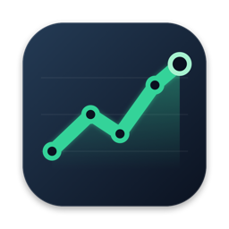
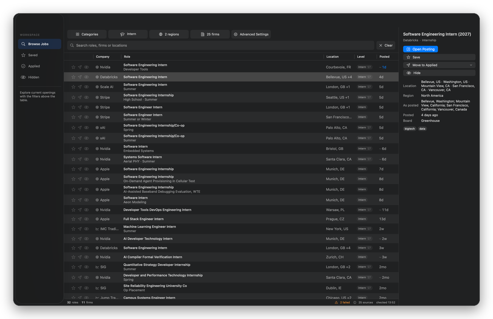
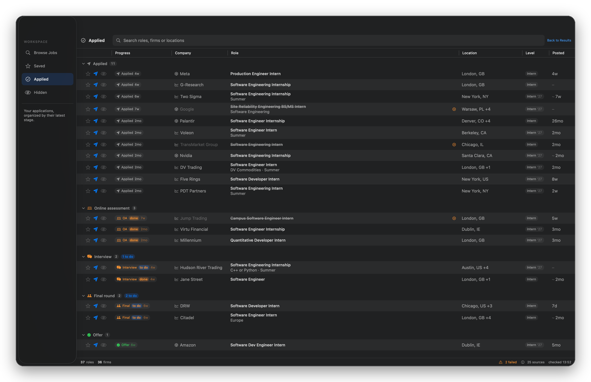
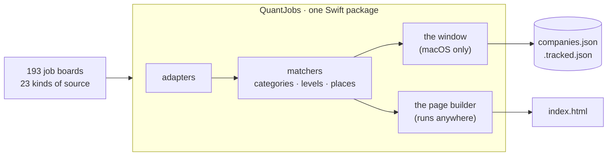
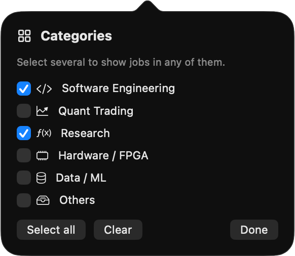

<p align="center">
  
</p>

<h1 align="center">quantjobs</h1>

<p align="center">
  Internship and new-grad postings, read straight from 187 firms' own job boards —<br>
  quant shops and big tech — with a tracker for everything you apply to.
</p>

<p align="center">
  <a href="https://github.com/mgman03/quantjobs/releases/latest"></a>
  
  
</p>

<p align="center">
  <a href="#install">Install</a> ·
  <a href="#browsing-on-the-mac">Browsing</a> ·
  <a href="#which-firms-are-wired-up">Firms</a> ·
  <a href="INTERNALS.md">Internals</a>
</p>



A native Mac app. No account, no server of your own, nothing sent anywhere.

Every posting comes from the firm's own board, so a role appears here when it
appears there rather than whenever an aggregator gets round to it. Dead links are
dropped before you see them, and a role posted in eight cities is one row.

## What it is for

Applying is a tracking problem as much as a searching one, so the same window does
both. Mark a role applied and it moves into a pipeline — assessment, interview,
final, offer, rejected — that survives the firm taking the posting down.



An online assessment you have been *given* is not one you have *sat*, so those are
two dates on one step, and anything still owed is badged **to do**.

## How it fits together

One Swift package. The window and the page builder share every adapter, matcher and
filter — the page is not a second implementation that has to be kept in step.



`--check` runs the whole pipeline in a terminal, which is how the boards are tested
without a UI. See [INTERNALS.md](INTERNALS.md).

## Install

```bash
git clone https://github.com/mgman03/quantjobs
cd quantjobs/QuantJobsApp
./make-app.sh
```

Needs the Xcode command-line tools (full Xcode is not required). The installer
checks for the tools before building and opens Apple's installation prompt if
they are unavailable. Finish installing them, then run `./make-app.sh` again.
The Swift package requires Swift 6 or newer.

It builds a release binary, wraps it in
QuantJobs.app, installs it to `/Applications`, and drops a `quantjobs` command into
the first of `~/.local/bin` or `/usr/local/bin` already on your PATH — that is what
makes the `quantjobs …` lines below typeable, since the binary itself lives inside
the bundle where nothing can find it.

An app you built is not quarantined, so macOS opens it without argument.

**After that it updates itself.** On launch it asks GitHub whether there is a newer
release; if there is, a bar appears with the version, what changed, and an Update
button. It downloads the release's disk image, checks it really is QuantJobs and
really is newer, swaps itself out and relaunches. Nothing is installed without you
clicking Update, and the check is one unauthenticated GET.

That is the only reason a `.dmg` exists — it is what the updater consumes, and what
to hand to someone without a toolchain. Installing from one by hand works, but it
arrives quarantined, so macOS refuses it once and you have to go to **System
Settings ▸ Privacy & Security ▸ Open Anyway**. Building is the shorter path. If you
do want an image, `./make-app.sh --dmg` writes one.

**Keep the checkout out of `~/Desktop`, `~/Documents` and `~/Downloads`.** macOS
gates those three, so an app reading its config from one asks permission on every
rebuild.

## The page on your phone

A personal extra rather than part of the app: the scheduled GitHub job also builds
a password-protected page of the same results and syncs marks with the app. How it
is wired, and how to run your own, is in [docs/phone-page.md](docs/phone-page.md).

## Browsing on the Mac



The Categories picker above the results stays open while you combine Software
Engineering, Research, Data / ML, or other disciplines. Others contains jobs
outside the named categories. An empty selection shows no jobs; use Select all
to show every category, including Others.
The selection survives a restart. Advanced Settings opens a panel with dates,
intake, exclusions and display choices. The five equally sized controls stay on
one row, switching to icons when space is very tight.

With refresh on launch enabled, the app starts fetching as soon as local data is
loaded. Cached rows are a preview while that happens. A completely failed fetch
keeps the previous cache and does not label it freshly updated. Quick boards
answer alongside slow multi-request sources, so progress starts without waiting
for the slowest ten boards. On Macs whose proxy settings point at an unresponsive
`http://wpad/wpad.dat`, board requests connect directly rather than waiting for
the proxy auto-configuration lookup to time out.

The internship filter requires internship or placement wording in the title or
board's department. Student eligibility, discovery events and spring insight
programmes alone no longer qualify. Those postings remain available at All levels.
Experienced grades such as Software Engineer II and team names such as "Co-op and
Marketplaces" do not count as internships. Titles keep level words like "Intern"
beside the role, and show meaningful team or qualification detail on a second
line. Locations already in the Location column and intake years already in the
Level badge are omitted there. The original title remains on hover.
"High School Internship, Software Engineering" reads as Software Engineering
Internship with High School below it; spring and summer stay below the role while
their intake year stays in the badge.

Firm tiers are an editorial shortlist, with a narrower Tier 1 and consistent tiers
across each firm's boards. See [the tier criteria](docs/firm-tiers.md).

## Which firms are wired up

193 board entries across 187 firms, read through 23 kinds of source. Most are
ordinary ATS boards — Greenhouse, Lever, Ashby, Workday, SmartRecruiters, Oracle
Cloud, Eightfold, Jibe. The rest needed adapters of their own:

| firm | why |
| --- | --- |
| Jane Street | its Greenhouse board is experienced hires only; students come from the JSON its own site reads |
| Meta | metacareers.com refuses anything without `Sec-Fetch-*` headers; behind that, a sitemap and a `JobPosting` on each page |
| Stripe | Greenhouse keeps answering for roles Stripe has taken down, so it is cross-checked against stripe.com |
| Google, Apple | read from their own careers sites |
| D. E. Shaw, G-Research | no ATS at all; one hydrates a Next.js payload, the other server-renders its cards |
| Citadel, Optiver, Two Sigma | own careers platforms |
| Hudson River Trading, Marshall Wace, Plaid | read from their sitemaps |

**Nine firms have nothing readable**, and each carries a dated `note` in
`companies.json` saying what was tried: Goldman Sachs and Cisco render everything
client-side and hide the endpoint; Tesla, Bloomberg, BlackRock and Microsoft answer
403 to scripted callers; Bridgewater, ExodusPoint and Quantlab publish no listings
at all.

`enabled` is the shipped default: every board with something readable starts on.
Your own Firms selection is kept in `.firms.json` beside it, which is gitignored, so
switching firms on and off never shows up as a change to the repository.

## Configuring

`companies.json` is the firm list:

```json
{ "name": "Jump Trading", "ats": "greenhouse", "token": "jumptrading",
  "enabled": true, "tags": ["hft", "prop"], "tier": 1, "segment": "Tier 1" }
```

- **`ats`** — which adapter. Most take a `token`; Workday and Oracle take a host and
  a site. See [INTERNALS.md](INTERNALS.md#board-adapters).
- **`tags`** — `quant` and `bigtech` decide which half of the Firms picker a firm
  lands in; the rest are descriptive.
- **`tier`** / **`segment`** — how the picker groups them. Judgement calls, so edit
  them freely.
- **`query`** — narrows a board server-side. Worth setting on a big tenant: JPMorgan
  posts 7,388 roles, and `internship` cuts that to 338 without losing a programme.

`categories.json` decides what counts as software, quant trading, quant research and
so on; `locations.json` is the gazetteer that makes `US, CA, Santa Clara` and
`Santa Clara, California, United States` the same place.

## Updating

Covered above — the app offers it and installs it. **QuantJobs ▸ Check for Updates…**
asks on demand.

Your saved and applied roles, settings and on/off choices live outside the app and
are kept. The firm list is refreshed on first launch: firms added since your version
arrive, and firms you switched on or off stay how you left them.

Updating this way never trips Gatekeeper, because quarantine is applied by browsers
rather than by the network.

## Notes

- **First-seen dates are shared, not per-machine.** A posting with no date from its
  board shows when the *tracker* first saw it, from a ledger the scheduled fetch
  keeps on the repository's `state` branch. Without it, a rebuild that starts from
  nothing calls every undated posting "found today", every hour, for ever.
- `.tracked.json` holds what you have saved, applied to or hidden, and the timeline
  for each. It survives a board deleting the posting.
- Boards are fetched concurrently with retries; a firm that fails is reported in the
  status bar and never takes the run down.
- Nothing is authenticated — these are the same public endpoints the firms' own
  careers pages call.
- A full run is about 23 seconds for 193 boards. `quantjobs --check --timing` prints
  where it goes.

## More

[INTERNALS.md](INTERNALS.md) — the adapters, the matchers, the checks, and how to
add a board.

## Author

Mykhaylo Gershman · [github.com/mgman03](https://github.com/mgman03)
