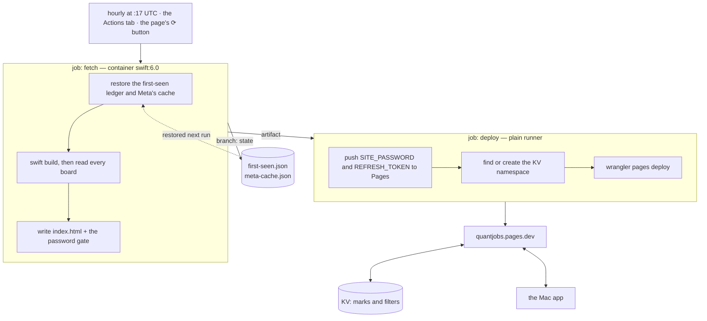

# The page on your phone

A personal extra, not part of the app: the maintainer's way of reading the same
results on a phone. Nothing in the Mac app needs it, and it is documented here
rather than in the README so it does not read like a service anyone else is
offered. The one piece the app does use is the first-seen ledger the same
scheduled job keeps — see the README's Notes.


The same scraper runs on GitHub's runners every hour, builds one self-contained
HTML page with every filter the app has, and publishes it to Cloudflare Pages. Free
at every step, and it keeps working with the Mac shut.

**It is your page, not a service.** There is no login because there are no accounts:
the deploy publishes to a Cloudflare project in your own account, and the URL below
is the one this repository's owner happens to have. `*.pages.dev` names are globally
unique, so a second person cannot deploy to it even by accident — theirs is
`something-else.pages.dev`, holding their postings and their marks, reachable with
their password. Nothing is shared between two people running this, in either
direction.

Three things name this repository, and a fork should change them: the project name
in `.github/workflows/fetch.yml`, `Updater.repo` (which decides whose releases the
app offers you), and `SharedLedger.url` (whose first-seen dates it reads). The
worker learns its own repository from the deploy, so the ⟳ button follows the fork
without being told.



Turning it on takes three secrets in **Settings ▸ Secrets and variables ▸ Actions**:

| secret | what it is |
| --- | --- |
| `CLOUDFLARE_API_TOKEN` | My Profile ▸ API Tokens, with *Cloudflare Pages: Edit* and *Workers KV Storage: Edit* |
| `CLOUDFLARE_ACCOUNT_ID` | the id in the dashboard URL |
| `SITE_PASSWORD` | whatever you want the page to ask for |
| `REFRESH_TOKEN` | optional — a fine-grained PAT with *Actions: read and write*, which is what makes the page's ⟳ button work |

The page lists what you applied to and were turned down for, so it is not published
open. `site/_worker.js` asks for `SITE_PASSWORD` over HTTP Basic auth — the
browser's own prompt, which Safari saves to the keychain. Deliberately **not** the
Pages "Access policy" toggle: that covers preview deployments only and leaves the
real URL open.

**Marks and filters sync both ways.** Star a role on the train and it is starred in
the app. Conflicts resolve per posting by whichever side was edited last, except an
application's steps, which are merged — the Mac holding "applied 3 June, OA 20 June"
and the phone adding an interview ends with three steps, not with whichever was
touched last.

On the Mac, once:

```sh
quantjobs --check --sync-setup https://<your-project>.pages.dev   # asks for the password
quantjobs --check --sync                                     # what the phone knows
```

That writes `.sync.json`, `chmod 600`, gitignored. The app syncs on launch, two
seconds after any mark, and on ⇧⌘S.

**Applied is a pipeline, not a list**, as it is in the app: grouped by stage, each
group counting its rows and badging what is still owed. The tab counts count what
the list draws — with merging on, one role in eight cities is one row, and the tab
used to say 995 above a list of 615.

The page is built for a thumb: 44px targets, nothing focusable under 16px (Safari
zooms in on a smaller field and does not zoom back out), a header that folds while
you scroll, and six seconds to undo a mis-tap.
